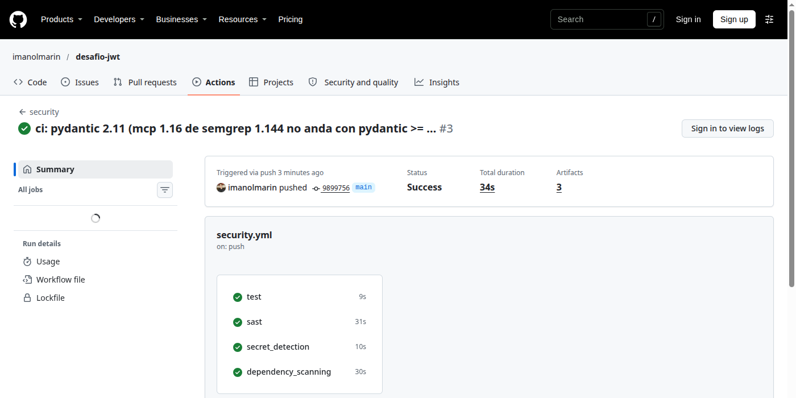
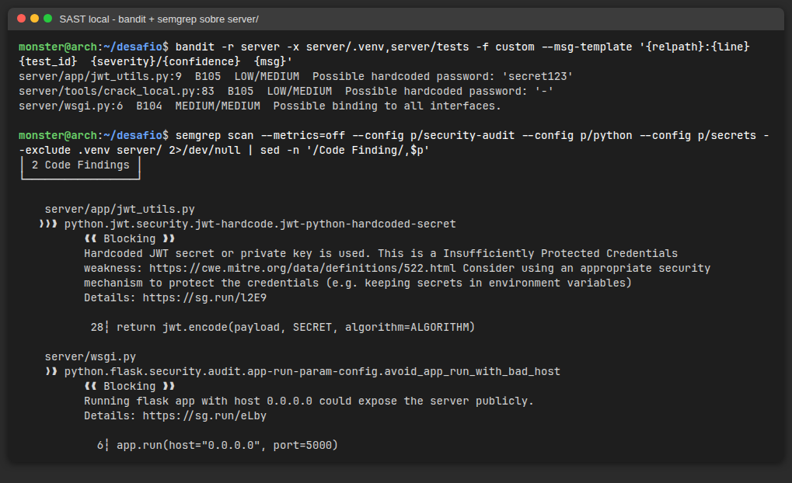
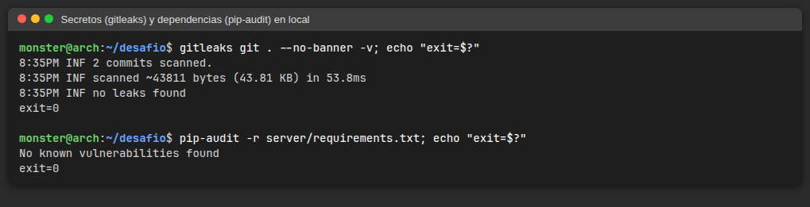
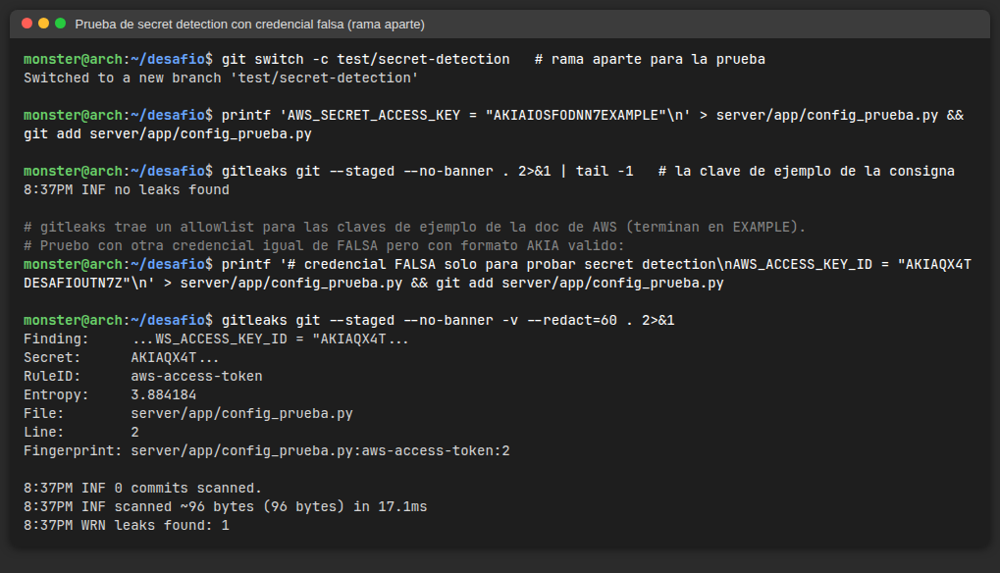
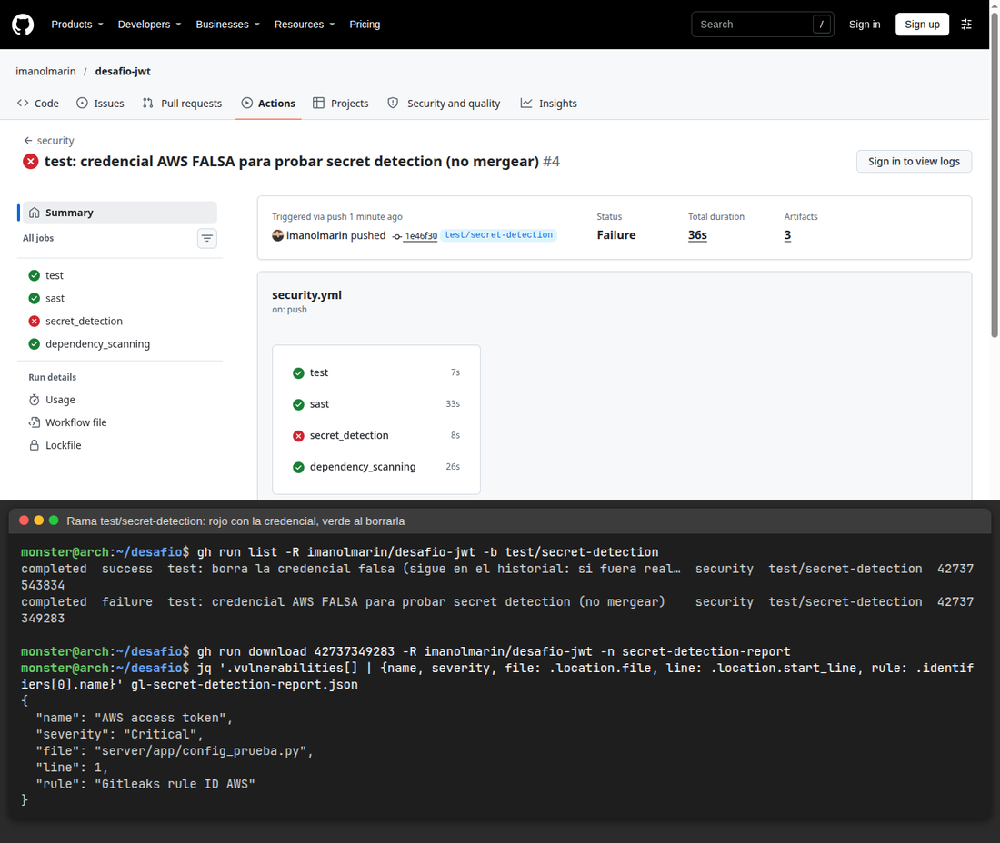

# SAST, secret detection y análisis de dependencias

> **Nota sobre la plataforma:** todavía no tengo acceso al GitLab de la cátedra, así que el repo está en **GitHub** y el pipeline corre en **GitHub Actions** (`.github/workflows/security.yml`), replicando los jobs de los templates de GitLab con las mismas herramientas de fondo (Semgrep para SAST, Gitleaks para secretos). El `.gitlab-ci.yml` con los `include` pedidos ya está en la raíz para cuando el repo se migre.

## Pipeline

| Job | Qué corre | Reporte (artifact) | ¿Corta el pipeline? |
|---|---|---|---|
| `test` | `pytest -q` (incluye el ataque completo) | — | Sí, si fallan los tests |
| `sast` | Semgrep (`p/security-audit`, `p/python`, `p/secrets`) + Bandit | `gl-sast-report.json`, `bandit-report.json` | No: igual que el SAST de GitLab, informa (el código es vulnerable a propósito) |
| `secret_detection` | Gitleaks sobre **todo el historial** de git | `gl-secret-detection-report.json` | **Sí**: un secreto commiteado hay que rotarlo |
| `dependency_scanning` | `pip-audit -r server/requirements.txt` | `gl-dependency-scanning-report.json` | No |



Equivalente GitLab (`.gitlab-ci.yml`):

```yaml
include:
  - template: Security/SAST.gitlab-ci.yml
  - template: Security/Secret-Detection.gitlab-ci.yml
  - template: Jobs/Dependency-Scanning.gitlab-ci.yml
```

## Análisis local (antes de subir)

Todas las herramientas corren contra la copia local; solo bajan reglas / bases de vulnerabilidades. El código no se manda a ningún servicio (`semgrep --metrics=off`, sin login).

| Categoría | Comando |
|---|---|
| SAST | `bandit -r server -x server/.venv,server/tests` |
| SAST | `semgrep scan --metrics=off --config p/security-audit --config p/python --config p/secrets --exclude .venv server/` |
| Secretos | `gitleaks git . -v` (historial) / `gitleaks git --staged .` (antes de commitear) |
| Dependencias (SCA) | `pip-audit -r server/requirements.txt` |




### Resultados y clasificación

| # | Herramienta | Archivo:línea | Regla | ¿Verdadero positivo? | Comentario |
|---|---|---|---|---|---|
| 1 | Semgrep | `server/app/jwt_utils.py:28` | `jwt-python-hardcoded-secret` (CWE-522) | **Sí** | Es exactamente la falla del desafío: el secreto que crackeamos |
| 2 | Bandit | `server/app/jwt_utils.py:9` | B105 hardcoded password | **Sí** | El mismo secreto, visto desde la asignación |
| 3 | Semgrep / Bandit | `server/wsgi.py:6` | `app.run(host="0.0.0.0")` / B104 | Sí, de bajo impacto | Expone el server de desarrollo en todas las interfaces; para el lab debería ser `127.0.0.1` |
| 4 | Bandit | `server/tools/crack_local.py:83` | B105 hardcoded password `'-'` | **No** (falso positivo) | Es el valor `-` que significa "leer de stdin"; Bandit lo marca porque se compara con una variable llamada `token` |
| — | Gitleaks | — | — | Falso negativo | `secret123` no tiene la entropía ni el formato de ningún proveedor conocido: Gitleaks no lo ve. Por eso conviene combinar secret detection con SAST |
| — | pip-audit | — | — | — | Sin CVEs conocidas en `flask`, `PyJWT`, `pytest` a la fecha |

**Lo que ninguna herramienta encontró** (revisión manual): la confianza en `balance`/`isVip` del token y en `precio` del body en `routes.py` (CWE-602). Son fallas de **lógica de negocio**: no hay una función peligrosa ni un patrón sintáctico que buscar, así que el SAST no las ve. Esa es la principal limitación del análisis estático.

## Prueba de secret detection con credencial falsa

En la rama `test/secret-detection` agregué `server/app/config_prueba.py` con una credencial **falsa**:

1. Con la clave que sugiere la consigna (`AKIAIOSFODNN7…EXAMPLE`) Gitleaks **no** reporta nada: es la clave de ejemplo de la documentación de AWS y Gitleaks la tiene en su allowlist para no generar ruido con documentación (el Secret Detection de GitLab está basado en Gitleaks, así que es esperable que se comporte igual).
2. Con otra clave inventada con formato válido (`AKIAQX4TDESAF…IOUTN7Z`, no corresponde a ninguna cuenta) Gitleaks la detecta con la regla `aws-access-token`, en local y en el pipeline.
3. Después la borré en un nuevo commit. **El job sigue fallando**, porque escanea todo el historial y el secreto sigue estando en el commit anterior. Esto es lo esperable: borrar el archivo no "des-filtra" la credencial. Si hubiese sido real, lo correcto es **revocarla/rotarla** en AWS y recién después limpiar el historial (o descartar la rama, como hice: la rama nunca se mergeó a `main`).




## Herramientas elegidas

| Herramienta | Para qué sirve | Por qué la elegí |
|---|---|---|
| **Semgrep** | SAST multilenguaje por patrones/flujo: inyección, crypto débil, secretos de JWT, configuraciones de Flask | Es el analizador que usa el template SAST de GitLab para Python, así que lo que veo en local es comparable con el pipeline. Tiene una regla específica para secretos JWT hardcodeados, justo la falla del desafío. Con `--metrics=off` no manda nada afuera |
| **Bandit** | SAST específico de Python (AST): `eval`, `subprocess` con shell, hashes débiles, passwords hardcodeados, bind a `0.0.0.0` | Corre 100 % offline, sin configuración, muy rápido; complementa a Semgrep con reglas propias de Python |
| **Gitleaks** | Detección de secretos (API keys, tokens, claves privadas) en archivos y en todo el historial de git | Es el motor del Secret Detection de GitLab; binario único, sin red; sirve igual como pre-commit (`--staged`) y en CI |
| **pip-audit** | SCA: compara `requirements.txt` contra la base de vulnerabilidades de PyPI/OSV | Herramienta oficial de PyPA, solo necesita el `requirements.txt` y descarga la base de CVEs, no sube el código |
